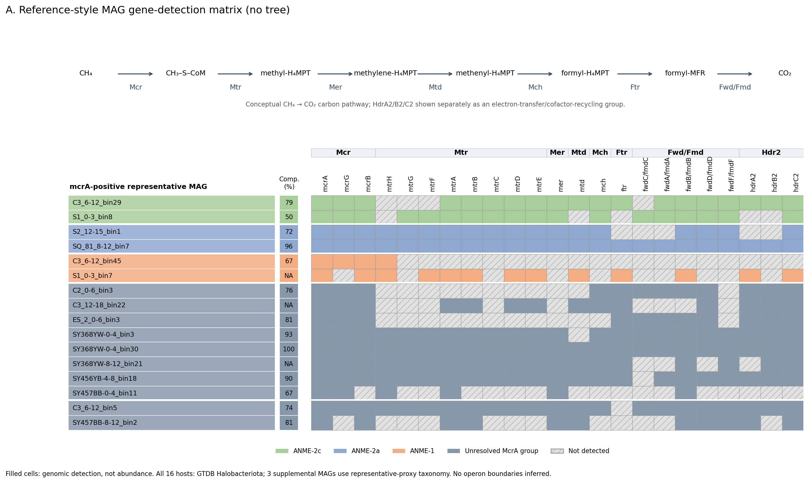
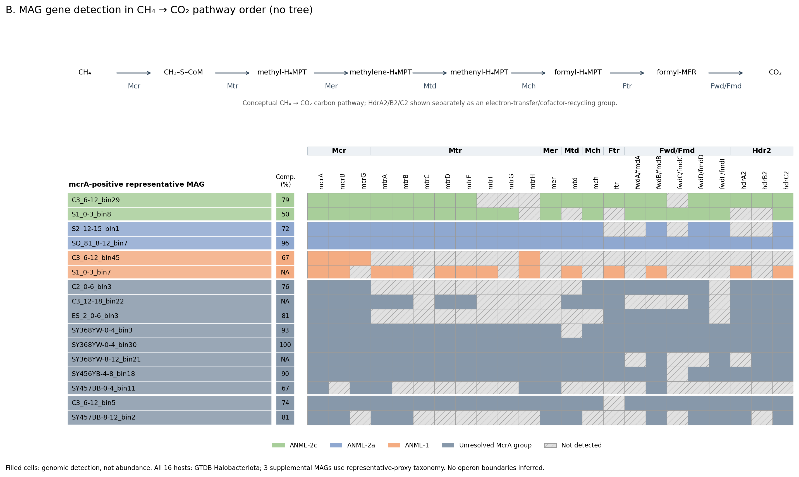
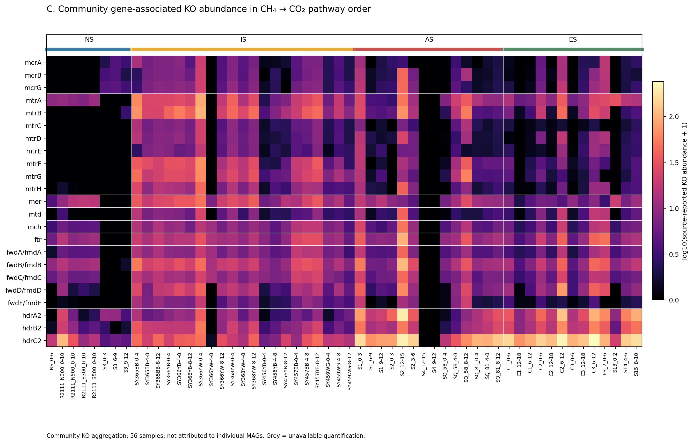

# 冷泉甲烷循环的代谢分析：23个功能KO、MAG携带、宿主分类与热图

此目录保存2026-10-16的冷泉甲烷循环代谢分析快照，重点关注古菌产甲烷与逆向产甲烷相关的23个KO，以及NS、IS、AS、ES四类生境的56个宏基因组样品。研究对象包括目标功能基因携带MAG，以及其中经上游证据审查选出的mcrA阳性代表。

这里的“甲烷循环”指本项目的分析主题；本次23KO集合主要覆盖产甲烷/逆向产甲烷相关代谢潜力，不代表已经覆盖甲烷循环的全部生化途径，也不是对甲烷氧化速率的直接测量。

详细方法见[METHODS_zh.md](METHODS_zh.md)，文件字段见[TABLE_DICTIONARY_zh.md](TABLE_DICTIONARY_zh.md)，结果限制见[RESULTS_zh.md](RESULTS_zh.md)。

## 基本步骤

1. 上游全量候选筛选：在1449个原始MAG中结合K00399注释和McrA HMM查找候选，并复核McrB/McrG；经去冗余与证据审查选出16个mcrA阳性代表。本目录沿用该上游结果，不重新执行全量蛋白筛选或建树。
2. 从808个原始去冗余代表的KO/HMM结果及3个补充阳性MAG提取指定23个KO。仅保留严格注释/HMM命中和上游已接受的McrA救回证据，按MAG/蛋白/KO去重。
3. 为携带任一目标KO的MAG整理bin名称、检出基因列表和GTDB分类。补充MAG的同簇代理分类单独标记，完整度不作推算。
4. 分别输出MAG数、蛋白ORF记录、MAG×基因检出矩阵和基因×56样品丰度。存在矩阵不能替代丰度。
5. 将KO标签转换为基因名称，绘制参考图排列和CH4→CO2路径排列两版无树热图；Hdr2单列为电子传递/辅酶再生组。
6. 核验23个KO、56个样品、MAG集合一致性、去冗余簇数及分类范围。结果见verification.json。

## 统计结果

| 项目 | 数量或范围 |
|---|---|
| 原始去冗余代表中接受检查的MAG | 808 |
| 携带任一目标KO的原始代表 | 344 |
| 补充MAG记录（与原代表同簇） | 3 |
| 携带MAG记录总数 / 独立dRep簇 | 347 / 344 |
| 门类标签 | 43 |
| 蛋白-KO命中记录 | 1876 |
| mcrA阳性重点代表 | 16 |
| 有直接定量的阳性代表 | 13 |
| 样品数：NS / IS / AS / ES | 8 / 21 / 14 / 13 |

16个阳性代表的宿主门标签均为Halobacteriota，其中3个使用代理分类。当前沿用上游分型：ANME-1为2个、ANME-2a为2个、ANME-2c为2个，其余10个保持未解析或产甲烷近缘未解析。没有用23个KO新增ANME亚群判定。

## 文件与复现

- Excel：携带bin、门类分类、统计、检出矩阵、ORF及丰度独立sheet。
- tables/：机器可读TSV；inputs/：重整表格所需的上游证据快照。
- prepare.py：仅依赖Python标准库，重建23KO统计表。
- plot.py、plot_config.json：根据tables生成PNG、SVG和PDF科学图。
- figures/：两版16MAG重点图、两套56样品丰度图及全部347记录的分页图。
- RESULTS_zh.md：数据限制与图例解释；manifest_sha256.json：文件校验值。

在此目录执行：

```bash
python3 prepare.py
python3 verify.py
python3 -m pip install -r requirements.txt
python3 plot.py
```

表格重整已在原分析环境执行并核验；上述依赖未锁定版本，重绘时字体或布局可能随环境变化。Excel为已导出的结果快照，以上命令不重建Excel。

## 解释边界

携带共享一碳代谢或电子传递基因的细菌不能自动归为ANME。23KO检出不能证明甲烷氧化方向、活性或碳通量，也不单独作为完整通路判据。3个补充MAG无直接TPM；部分mtrB/mtrF已注释ORF未进入Salmon索引，相关汇总为NA。全群落KO丰度保留来源量纲，与13个阳性MAG的基因TPM分别展示。

基因名称依据[KEGG M00567](https://www.kegg.jp/entry/M00567)及对应KO条目；Hdr名称为[hdrA2](https://www.kegg.jp/entry/K03388)、[hdrB2](https://www.kegg.jp/entry/K03389)、[hdrC2](https://www.kegg.jp/entry/K03390)。参考图仅用于无树检出矩阵的组织样式，不复制其物种数据，也不推断操纵子、基因邻接或Fwd/Fmd旁系同源关系。

本快照不包含原始reads、MAG序列、数据库、服务器连接配置或凭据。

## 图件预览

参考图结构版本（没有发育树，填色表示基因检出）：



甲烷氧化为二氧化碳的概念途径顺序版本：



全群落基因相关KO丰度（23基因×56样品，与MAG检出分开）：


